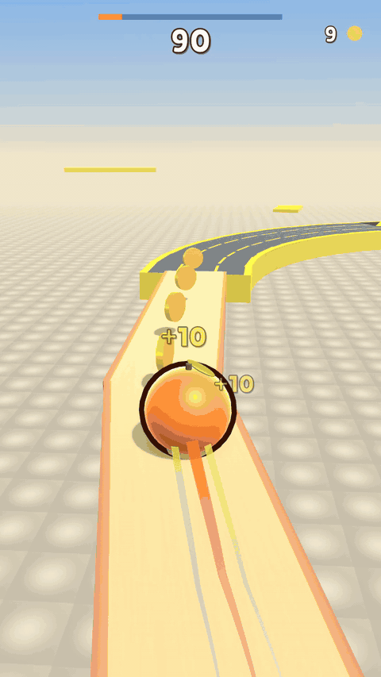
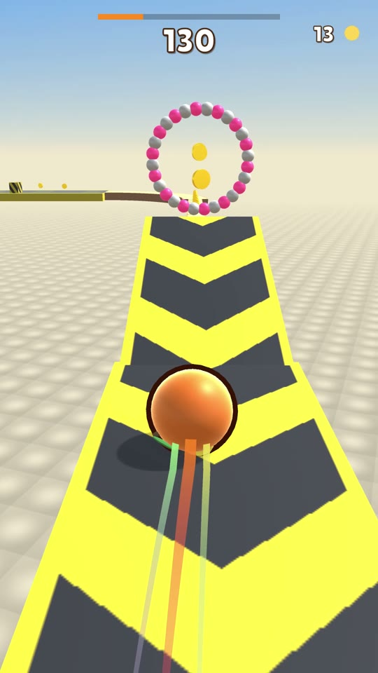
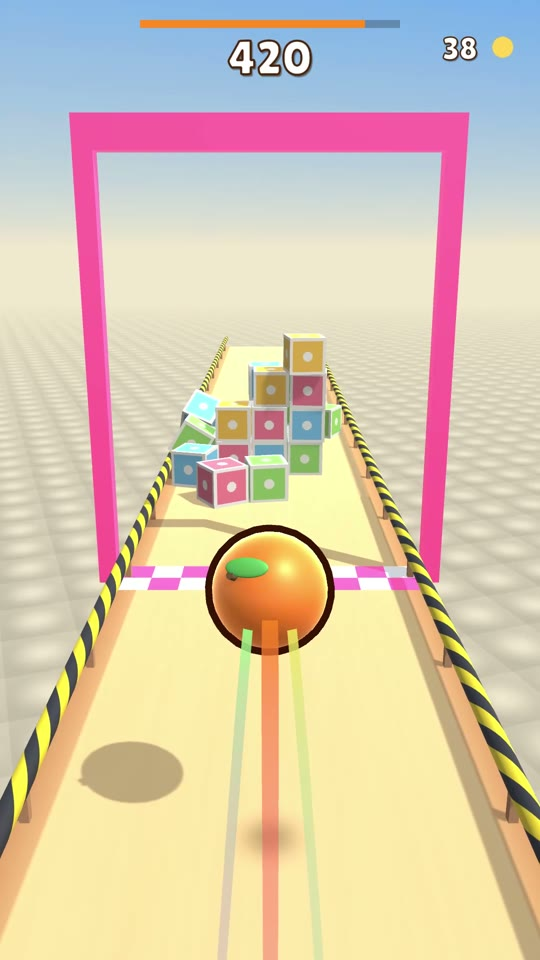

# Tumble Lane

Roll Pip the clementine down a narrow obstacle course floating above a cream cushion, steer through a spinning hoop, and don't fall off.

  
  

## How to play

- Pip rolls forward on its own. **Drag left or right** (or **A/D**, **arrow keys**) to steer. The first press starts the roll.
- The course: a wooden run-up, a thin plank, an asphalt bend, a boost strip into a ramp, a jump through a spinning hoop over a gap, a narrow beam, sliding hazard blocks, zigzag planks, a railed downhill, a second boost jump, and a finish straight with a tower of crates.
- Coins give +10, hoops +20 and the finish +100. If you fall off, "OOPS!" and you restart from the last checkpoint pad. Reach the finish line for "LANE CLEAR!".

## How to open it

1. Open the folder in **Unity 6000.5.4f1** (Built-in render pipeline, Input System). Unity restores the packages from `Packages/manifest.json`.
2. Open the scene `Assets/TumbleLane/Scenes/TumbleLane.unity`.
3. Press **Play**, then click, drag or press a key to start rolling.

Everything is built in code from primitives and procedural textures. The Satura Space editor hooks are inside `#if UNITY_EDITOR && SATURA_SPACE`, so the project opens and plays in plain Unity.

## Created by Satura Space

This game was made with [Satura Space](https://github.com/saturadev/satura-space) ([saturaspace.com](https://saturaspace.com)), a free, open source tool that turns a clip into a playable game. A TikTok link ([inspired by @newgamehub6](https://www.tiktok.com/@newgamehub6/video/7709324002140917022)) was pasted into Satura Space. A Claude agent watched the clip's frames, searched GitHub for how others solved the core mechanic (a rolling ball and a chase camera), built the game in Unity, playtested it with a bot and filmed it.

## Model and cost

Claude Opus 5.5 (xhigh effort) in Claude Code. At Anthropic API list prices this run would have cost about **$10.85**, including a later pass to make the ball easier to follow. That is an estimate: 440 input tokens, 131,925 output tokens, 26,202,017 cache-read tokens and 371,621 cache-write tokens (1 hour), summed across every session for the game.

## Credits

- Idea: [@newgamehub6](https://www.tiktok.com/@newgamehub6/video/7709324002140917022) on TikTok.
- Chase camera technique (target plus rotated offset, SmoothDamp, LookAt) adapted from [VladimirPirozhenko/AwesomeRunner](https://github.com/VladimirPirozhenko/AwesomeRunner), MIT licence.
- Idea only, no code: [AlexandrPeshkov/ZigZag](https://github.com/AlexandrPeshkov/ZigZag) (MIT) and Unity-Technologies/EndlessRunnerSampleGame (no licence, nothing taken).
- Game code and art are original and released under the MIT licence.
- Font: [Lilita One](https://github.com/google/fonts/tree/main/ofl/lilitaone) by Juan Montoreano, SIL Open Font License 1.1.
- TextMesh Pro Essential Resources (Unity package content) include Liberation Sans, SIL Open Font License 1.1.
